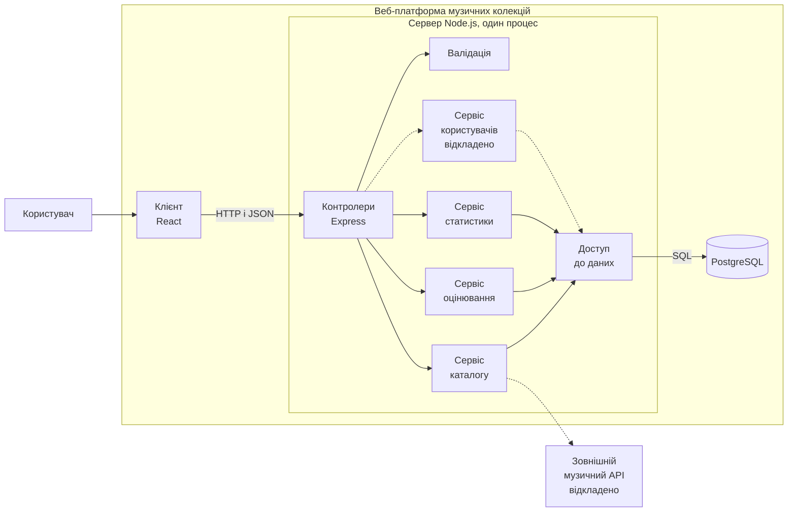

# Архітектура програмного забезпечення

Документ описує архітектуру веб-платформи управління музичними колекціями та їх аналізу. Межі прототипу такі самі, як у [README.md](../README.md).

## 1. Порівняння варіантів

Розглянуто три варіанти: багатошарова архітектура, MVC і мікросервіси. Багатошарова архітектура і MVC працюють на різних рівнях, тому їх можна поєднувати. Шари ділять код сервера за відповідальністю, а MVC ділить ролі інтерфейсу, контролерів і даних. Варіанти порівняно за чотирма критеріями.

**Багатошарова архітектура**

- Відповідність сценаріям: підходить, сценарії прості й послідовні.
- Складність реалізації: низька, один процес сервера.
- Тестованість: висока, розрахунок можна перевірити без бази і HTTP.
- Можливість змін: висока, новий сервіс додається без зміни інших.

**MVC**

- Відповідність сценаріям: підходить частково, не розділяє логіку розрахунку і доступ до бази.
- Складність реалізації: низька, поділ ролей відомий.
- Тестованість: середня, логіка може потрапити в контролери.
- Можливість змін: середня, зміни обмежені трьома ролями.

**Мікросервіси**

- Відповідність сценаріям: не підходить, сценарії малі й окремі сервіси не потрібні.
- Складність реалізації: висока, кілька сервісів і окреме розгортання.
- Тестованість: середня, потрібні тести взаємодії сервісів.
- Можливість змін: висока, але потрібна велика система.

## 2. Вибір

Обрано клієнт-серверний застосунок. Клієнт на React працює в браузері й звертається до сервера по HTTP. На сервері використано багатошарову архітектуру: контролери, сервіси, доступ до даних. Ролі розділено за MVC: View це React, Controller це контролери Express, Model це сервіси і дані через Prisma.

Область застосування, переваги й обмеження:

1. Клієнт-сервер. Застосовується між браузером і сервером. Перевага: клієнт і сервер можна розробляти окремо. Обмеження: потрібно узгодити формат API.
2. Багатошарова архітектура. Застосовується на сервері. Перевага: розрахунок середнього бала можна тестувати окремо. Обмеження: навіть прості запити проходять через усі шари.
3. MVC. Застосовується для розподілу ролей у застосунку. Перевага: зрозумілий поділ інтерфейсу, контролерів і даних. Обмеження: не розділяє логіку і доступ до бази, тому доповнений шарами.

Вимоги й обмеження проєкту, що вплинули на вибір:

1. Проєкт робить один розробник за один семестр. Мікросервіси для цього занадто складні, тому сервер працює одним процесом.
2. Запуск планується через Docker, база PostgreSQL в окремому контейнері.
3. Середній бал розробляється за TDD і має рахуватись окремо від Express і бази. Для цього потрібен окремий шар сервісів.
4. У прототипі один користувач, без реєстрації та зовнішніх API. Ці функції додадуться в наступному семестрі, тому їх треба буде додавати як нові сервіси без зміни наявних.

У прототипі першого семестру буде реалізовано: клієнт, контролери, валідацію, сервіси каталогу, оцінювання і статистики, доступ до даних через Prisma, PostgreSQL.

Відкладено, як у README: сервіс користувачів з реєстрацією і профілями, інтеграцію із зовнішнім музичним API, розширену статистику з графіками, обмін колекціями і друзів, адміністративні функції. Графіки, обмін колекціями, друзі й адміністрування на діаграмі не показані.

## 3. Компоненти

1. Клієнт, React і Vite. Інтерфейс користувача: додавання треків, перегляд треків, альбомів і виконавців, форма оцінювання, список оцінених треків, статистика. Інтерфейс: HTTP запити до сервера, дані у форматі JSON. Залежить від контролерів.
2. Контролери, Express. Приймають запити, викликають валідацію і сервіси, повертають відповідь або помилку. Інтерфейс: REST API. Залежать від валідації і сервісів.
3. Валідація. Перевіряє поля запиту, оцінки від 1,0 до 10,0 з кроком 0,1 і список вимкнених критеріїв. Інтерфейс: функції перевірки, які викликають контролери. Ні від чого не залежить.
4. Сервіс каталогу. Додає треки з виконавцем і альбомом, повертає списки і картки. Інтерфейс: методи сервісу для контролерів. Залежить від доступу до даних.
5. Сервіс оцінювання. Зберігає оцінки, рахує середній бал лише за активними критеріями. Інтерфейс: методи сервісу для контролерів. Залежить від доступу до даних.
6. Сервіс статистики. Формує список оцінених треків із сортуванням за рейтингом і базову статистику. Інтерфейс: методи сервісу для контролерів. Залежить від доступу до даних.
7. Доступ до даних, Prisma. Виконує запити до бази. Інтерфейс: методи отримання і збереження даних для сервісів. Залежить від PostgreSQL.
8. PostgreSQL. Зберігає треки, альбоми, виконавців і оцінки. Інтерфейс: SQL запити. Ні від чого не залежить.
9. Сервіс користувачів, відкладено. Реєстрація і профілі. Інтерфейс: методи сервісу для контролерів. Залежатиме від доступу до даних.
10. Зовнішній музичний API, відкладено. Окрема зовнішня система, не є частиною проєкту. Інтерфейс: HTTP. Сервіс каталогу буде звертатися до нього для імпорту даних.

Процеси під час роботи:

1. Клієнт працює в браузері. Під час розробки його запускає Vite.
2. Контролери, валідація, сервіси і доступ до даних працюють в одному процесі Node.js. Поділ на шари логічний, окремих серверів немає.
3. PostgreSQL працює окремо, у контейнері Docker.

Класи і методи будуть описані в практичній роботі №5.

## 4. Діаграма

Діаграма зроблена блоковою нотацією Mermaid і не є UML діаграмою компонентів.

Позначення:

1. Суцільна стрілка означає залежність: компонент на початку стрілки викликає компонент у кінці.
2. Підпис на стрілці показує протокол або формат даних.
3. Пунктирна стрілка і підпис «відкладено» означають частину, відкладену на наступний семестр.
4. Велика рамка показує межі системи. Менша рамка показує сервер, який працює одним процесом. Зовнішній API розташований поза системою.

## 5. Сценарій: оцінювання інструментального треку

1. Користувач вводить оцінки, вимикає критерії «Виконання» та «Зміст» і зберігає. Клієнт відправляє запит на сервер у форматі JSON.
2. Контролер передає дані на валідацію. Якщо дані некоректні, повертається помилка.
3. Контролер викликає сервіс оцінювання.
4. Сервіс рахує середній бал лише за активними критеріями. Ця логіка не залежить від Express і бази, тому її можна перевірити тестами Jest.
5. Оцінки й вимкнені критерії зберігаються в PostgreSQL через шар доступу до даних і Prisma.
6. Контролер повертає середній бал, клієнт показує його користувачу.

## 6. ADR-001. Вибір архітектури

Статус: прийнято.

Контекст: один розробник, один семестр, запуск через Docker, середній бал розробляється за TDD, стек React, Express, Prisma, PostgreSQL. Прототип з одним користувачем, без реєстрації та зовнішніх API.

Варіанти: багатошарова архітектура, MVC, мікросервіси.

Рішення: клієнт-серверний застосунок. На сервері багатошарова архітектура, ролі розділено за MVC. Сервер працює одним процесом, база в окремому контейнері.

Наслідки:

1. Середній бал тестується окремо від HTTP і бази.
2. Запуск і розробка простіші, ніж у мікросервісів.
3. Сервіс користувачів і зовнішній API можна додати без зміни наявних шарів.
4. Сервер не можна масштабувати по частинах, тільки цілком. Для прототипу це прийнятно.
5. Контролери викликають сервіси, сервіси викликають доступ до даних. Зворотні виклики не допускаються.